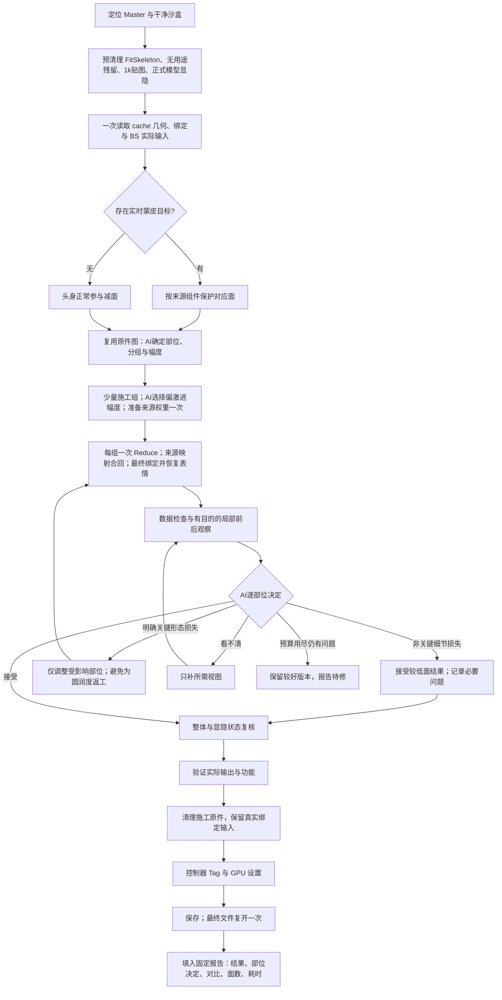

# Rig Master → Proxy Rig

唯一构建入口：`maya.asset.proxy_rig`。普通 Python 实现入口是本目录
`proxy_rig.execute(payload)`，MCP 通过同一 adapter 调用，不另写角色脚本。
完整输入和副作用以同目录 `capability.yaml` 及 `plan.py` 为准。

## Agent 的入口

本文件是本业务的 Agent 作业方法 owner，通用 CGI 操作 Skill 负责选入口、传输和恢复。
新会话、新角色从本入口读取当前方法与能力边界，不以旧角色 plan 或会话记忆代替。
`capability.yaml/plan.py` 固定输入，`mesh_reduce` 等共享 API 固定执行，
`delivery_review.py` 固定审查数据和交付状态，`report.py/delivery.html` 固定报告。
说明书被读取不等于已遵循；以当次方案、回执、实际阅图和审查结果验证。

用户通常只给角色名。先按项目配置解析最新 `chr/rig/rigMaster`；复用
`AssetResolver.resolve_latest` 或已有 `resolve-asset` CLI，规范大小写取实际
文件名。正式文件只读，初次复制与打开沿现有 CGI API；已有相符沙盒就继续。
不把双输入 tex→rig 解析器硬套成单 Master 解析。

用户为本次运行指定前台端口才使用该前台，否则沿现有 CGI 后台工作流运行；同次
运行继续复用选定会话，不能因发现任意前台就占用，也不把旧测试端口当新任务默认。
前台使用原工作区及 `scene_action=continue`。开始本任务可直接打开用户已指定的干净
沙盒源，不为用户正在检查的候选常规追加检查点；正式源始终只读。任何超时均恢复原 task_id，
不重发构建。业务 project 与 workspace_project 分开填写。

通过 `execute_api` 执行同一场景的三个阶段：

1. `mode=inspect`：复用 `hosts/maya/asset_info_collector.py` 的
   `resolve_cache_group / mesh_transforms_under / get_deform_input`，从项目配置
   `stages.rig.geom_roots` 定位 cache 正式输出，取得结构指纹、类别摘要与 inventory。
2. Agent 复用有效的原件图，按本轮问题补齐整体、局部或状态证据，形成 JSON plan。
   同类只看代表与异常；每次看图须写清关注点、实际观察及下一步决定。
3. `mode=apply`：在本次调用内重新核对当前场景及方案，完成写前预检、批量处理、
   检查、替换和保存，返回实际输出和完整报告路径。

### 已批准的 Proxy 预清理与观察

需要清理 Master 构建残留时，先用同一入口 `mode=prepare`，再 inspect。
已有 ngSkinTools 作者层先用 `maya.asset.maya_master_cleanup` 的
`profile=proxy_authoring, mode=fix` 清理，保留当前原生蒙皮权重；不能等到正式构建
权重预检拒绝后才补做，也不能误用完整 Master 清理配置。
`preparation.fit_skeleton=true` 在场景中定位实际存在的 FitSkeleton（含命名空间），
直接删除本地构建子树，不依赖固定层级。其他 `constant_subtrees` 提交明确 UUID；
保留仍需计算的常量输入。AdvancedSkeleton
动画曲线上的动态作者标记不是实际 input，不把它当绑定计算保护。
`discard_meshes` 用真实下游检查无用途的隐藏毛发基面；上游存在 BS 不等于
该输出仍有用途。Master 专用 data 继续用已登记 nodes.delete 清理。
`zero_weight_nodes` 仅断开无上游、精确为零的作者配置系数对应 blendWeighted
输入，并删除其独占无消费者的计算节点；当前帧为零的表情/动画权重不适用。
`textures_1k` 对每个目标目录只检查一次 texMaster_1k 是否存在，批量替换目录组件，
保留文件名和 UDIM 标记，不逐文件检查；显隐属性依据实际
连接选值，VisibilityCtr 与 Visibility_ctrl 都不能仅凭名字套值。

观察默认复用明确的前台原生视口、当前颜色变换及双面照明设置。
`report.capture_delivery_views` 按批应用显示配置；每个规格可传 image_size、
default_material 和 wireframe。原生相机按同一宽高比取景。禁止用角色脚本
另建灯光的后台渲染替代前台证据；当前截图 API 明确要求 GUI。
每个比较标签只取一组前后图；整体三视图、实际部位和必要着色图由用途决定。
不够清晰先纠正取景，不反复阅读同一张不可辨图。局部返工只重拍受影响标签。

共享减面在 skin 输入空间施工，使用原 bindPreMatrix、权重与驱动恢复形变；
当前姿态不同不构成拒绝理由。整件施工优先原生复制；只有实际分区或拼接才重建。
共享 mesh_io 保留源软硬标记、锁定法线、UV 和材质，不推断并修正所谓矛盾标记。
输出异常须定位首次出现差异的阶段，不用全局软化掩盖问题。
有 BS 不自动拆头：可保留功能施工分区但输出为一体，按来源点身份焊回施工边界，
重新映射静态 BS。活跃附着输入保留并明确列出，不能伪装成已删尽的施工原件。
源权重只准备一次；各阶段 timing_seconds 写进普通与区域权重结果，定位真实
瓶颈后再优化。最终回读验证不再重复求解。施工候选保存在 work；最终清理并
加控制器 Tag 后保存，正常仅复开最终文件一次。开发失败重试单独计入本次成本。

`mode=preview` 保留为可选只读审查入口：需要用户单独审方案时使用。常规自主处理
不先调用 preview 再 apply，后者本来就执行写前预检；preview 结果不充当下一次
apply 的执行许可或当前事实。不同 API 调用之间不复用旧的源 inventory/几何快照。

ysj 的 Master 专用 `Geometry/data`（含 `visData`）不交付 Proxy。用户已确认其用途；
先核配置层级下的精确完整路径、UUID、子树及对外依赖，再复用现有
`maya.scene.nodes.delete` 清理并回读，随后重新 inspect 生成新的场景指纹。
不按全场 `data/visData` 通配删除；遇到其它内容或有效绑定下游先核实。
该预清理与几何构建分阶段留回执；不假定每个公共原生命令都有独立 undo 条目。
不能为已确认不交付的数据再建立监测重接系统。

本入口本身不替代开放的造型判断。当前通用 `pipeline_execute_workflow` 没有前台
复用参数；不要把后台 resident 称为前台，也不要把一个静态 JSON 当作完整 AI 判断。

## 稳定判断顺序

自主作业按下列交接闭环，不为每个阶段新建 API：

| 阶段 | 固定交接物 | 继续条件；异常去向 |
|---|---|---|
| 定位与沙盒 | 当前 Master、来源身份、输入路径、运行会话 | 来源明确且只读保护；缺资产回定位 |
| 理解与观察 | 当前 inventory、功能/显隐类别、必要取景计划 | 从当前场景推导，未知机制保护或补证，不照搬旧角色参数 |
| 决策 | 完整覆盖的 plan、保护区、施工组、参数依据、review_views | 未标定评分不自动跨类别推广；几何组与输出兼容组分别决定 |
| 施工 | 共享 API 回执、实际结果、步骤耗时 | API失败按原 task_id恢复，不重复已接受的写入 |
| 数据与视觉审查 | 最终检查、实际查看的前后图、结构化 review | 数据通过不能代偿视觉；失败回对应源组和策略，不只写备注 |
| 交付 | Proxy、固定 HTML、同名 JSON 数据模型 | 只给出需修改/待审查/待用户验收，不自行代表用户验收 |
| 失败改进 | 原任务fact、原owner修改、回归、原入口复验 | 未修复或缺证据仍为待办，不标成已学习并闭环 |

`plan.review_views` 是源观察时决定的附加视图数组，每项含 label、part_id、purpose。
视图按问题选择：重复/成对构件需同图比较，辫子需背面近景，衣物需单件与身体组合，
切换部件需覆盖状态；不逐根拍同类羽毛，也不把固定三张图当成所有资产够用。
视觉失败先做有界代表验证，通过后回原入口；从源重做，避免在已减结果上累积损失。
学习复用原任务的已验证证据：方法缺口更新本文件，执行缺陷改原API，稳定可判项加
回归测试，再经原入口验证消费。已有owner承接时不另建同义Skill、lesson或学习台账。
仅写fact/改说明未改变实际行为时，不宣称已完成学习。无新增量不强写经验。

优先级：源保护 → 必须保留的功能及拓扑 → 关键造型和变形 → 优化收益。
每次都依据当前事实推导，不加载旧角色方案作为默认答案。

### 当前主流程：视觉决定，API 执行

允许丢失小细节及一定圆润度，允许可见棱角和简化分段；主要轮廓、体积、关键转折、
孔洞和同类部件的合理疏密是视觉判断对象。细节不够圆润本身不构成回退理由，
主要形体及部件关系可辨时优先保留较低面版本。用户已认可的 pengMoWang 辫子
5895→858 面是这一取舍的实例；以后资产复用接受尺度，不套用它的百分比或面数。
已认可与已拒绝的样例作为对照。AI 不预知唯一最优比例，也不把主观
打分包装成客观相似率。F-score 只用于可选诊断，不再作为常规减面的验收门。

常规 `geometry_search` 或区域 `search` 使用 `mode=visual`，Agent 按部位选择偏激进的
`initial_reduction`；95% 可作为密集部位的首档参考，不是全角色固定比例或验收指标。
实际功能保护面除外。每个施工组一次 Reduce，不调用评分或自动追分。Agent 用尽量少的
候选寻找主要形态仍清楚的低面结果：明显棱角、小细节及一定圆润度损失可接受，不为
表面更圆润反复回退；明确体积塌陷、重要轮廓缺失或结构关系难辨时才局部调整。
固定的是判断方法与操作顺序，比例由实际几何和视觉证据决定。整轮后汇总问题与用户
反馈更新后续策略。执行错误及绑定功能破坏当场修复，未通过项不得伪报通过。

同一模型内部可通过 `work_groups` 提交少量面集合：每项包含唯一 `name`、`faces`、
`reduction` 和 `reason`。面集合必须无重叠且完整覆盖本次可减区域。
普通合并按 sources/entries 顺序累计源面号；区域分支使用原模型面号。
不连通壳可按形状、密度及约束归组，连续面则由 Agent 明确语义边界与保护切口；
视觉模式不再自动把面面积二分当作语义分割。无需为每根羽毛创建一个 Maya 模型。

`semantic_regions.expression_body` 检查实际 BS 目标输入及其 skin：只有实时蒙皮
输入命中的来源组件对应面才保护；静态目标或无此类输入时整件可减，不按头/手名字
强制保护。静态修正仍按来源点映射恢复。实时目标还须满足执行器的索引对应条件；
无可靠对应时先解决映射，不能把“检测到目标”当作已经能恢复功能。



报告 `review.part_decisions` 每项记录 `part/decision/focus/observation/views`。
decision 仅为 accept、reduce_more、restore、need_view；视图须已实际查看。
视觉模式缺部位决定为待审查，继续减/回退为需修改，不能仅凭总检查通过进入验收。

静态试件保留为方法研究或用户明确要求的对照工具，不作为每个角色的常规前置。
常规按 Agent 选定参数正式构建，结束后集中审查与学习，避免重复几何和绑定计算。

- 先一次提取名字、层级、输出 shape、bbox、面数、蒙皮/变形器和显隐机制。
  名字、相邻或 bbox 相似只缩小候选；中间形态不当外观目标，隐藏不等于无用。
- 减面及合并只处理 cache 内。cache 外只审用途/依赖，不读取不需要的完整几何；
  有效代理蒙皮、表情传递、附着、辅助和控制关联必须保留。只有上游显隐/图层输入
  而无实际绑定、附着等下游用途的旧代理不因此受保护。确证无用途的残留可用
  显式 `discard` 决定清理，须给出理由及证据；位置在 cache 外不构成删除依据。
- 策略按造型类别决定，合并按实际机制分组。大量同类羽毛不逐根交 AI 审核。
  小件、长片、密集装饰、轮廓或关节关键件可能需要不同策略。
- 代表按类别规模分布取低、中、高及结构异常，主动调整取景及显示使证据可见。
  观察状态改变本身不应改变方案；新证据确实改变判断时记录原因。
- 分组与参数还须考虑 Reduce 实际约束：UV缝、硬边、材质边界及其真实用途。
  同组同百分比不保证组内分配均衡；整组表面评分不代表每个构件形态或布线合理。
  复用来源映射筛查异常消减分配，对异常族做少量代表复核。不得由一个无贴图案例
  推出全局关闭 UV 保护。共享搜索路径只对已知常量表面材质放宽UV边界约束；
  上游输入、置换/体积材质或未知shader仍保护。UV集及插值保留，实际约束和原因
  写入search.constraints；Agent继续复核组内分配。
- 先区分合理几何与冗余；合理部分保持，冗余部分一次按类别幅度处理。面数只是
  线索，不能设全角色统一减面比例或逐次小步尝试。
- 内部识别单位是面区域或连通壳，施工单位是少量处理组，不能止于 transform，
  也不按壳逐个创建模型和 Reduce。大量相似壳可以进入同一不连通面集合；高低密度
  组分别处理后再合回。连续表面内部仍须按显式 face IDs 分区并保护切口。
  `mesh_reduce.regions` 与公开 regional 模式已有面分区算子；区域的自动识别与
  视觉决策仍由 Agent 提供，不能把算子存在冒充自动识别已完成。
- `mesh_reduce.analysis` 是数值环境中的候选分析实现：libigl 连通壳、scikit-learn
  对数空间面密度聚类、libigl AABB 对应来源壳双向表面查询。返回面集合而不创建
  Maya 节点；聚类组数由调用指定，不把本次两组或比例作为所有资产默认。
  本分析接口仅验证不连通壳归组；自动施工的连续分区边界见下方有限寻档章节。比较包含原顶点、三角面中心
  和确定性表面采样；最大值是采样估计，不是严格 Hausdorff 上界，也不证明动画质量。
  相邻壳不能互相充当最近表面；缺壳或跨来源搭桥单独报告。
  公开 `mesh_reduce(mode=analyze)` 读取来源UUID及显式group_count，返回精简分组统计和
  `analysis_path`；完整面列表留数值产物，不塞进大回执。`regional` 和 `proxy_rig.apply`
  共用 `quality`：max_error为调用方选择的场景距离，max_retries为0至2，retry_factor
  在(1,2]；失败可error回滚或keep_region保留原区域。只重建失败组，在最终蒙皮前检测。
  容差须按部位和用途标定；不能把单资产阈值或有限重试说成自动找到最小可用面数。
  多来源region可以使用同一output_name，兼容父层级/显隐/绑定后静态拼接，只建一个
  最终skin；每段source_ranges与source_vertex_ids共同保存来源，不把不同来源点号混用。
  多来源表达式系统及组件集合不自动合并。数值请求复用已有蒙皮数值进程，不新建环境。
- 纯线框用于定位热点，着色加线框用于判断可见表面；黑线堆积可能来自多层重叠。
  AI 应检查主要轮廓、弯曲分段和同类代表，必要时才读局部曲率及权重变化作依据。
  不以线条像素密度、面数排名或同类统一比例单独裁决；合理长羽、尖端和功能区
  与密集短羽根部分开判断。新资产沿用这套顺序，不复用旧角色比例作为答案。
- 从实际 BS 输入、作用组件和骨骼权重确定功能区域；区域必须完整覆盖源面且不重叠。
  当前区域分支支持一个原生蒙皮与一个 local/pre-skin BS：头部保持实时目标的完整
  点对应，身体按保留下来的源点重建静态修正；头身可分别输出。切口保留边界点、
  同源权重、修正及法线。Wrap、切线空间 BS、相对中间形态等未支持链继续保护。
- 兼容合并须保留绑定空间、祖先/局部/shape 显隐输入、displayLayer、集合用途、
  UV 和材质语义。不同骨骼集合本身不是禁止合并的理由。
- 显隐包含 visibility、lodVisibility 及显示覆盖；同父组驱动优先保留原组，局部
  Transform/Shape 驱动接续到对应输出，不把当前值当所有状态。独立切换不得合并，
  控制组不能按空组清理；有效的其他输出连接同样保护，未支持则不替换来源。
- 原模型只有在派生结果及依赖验证后才替换。控制器、骨骼、有效约束/表达式本期
  保留；不得调用全场 cleanUpScene 或按 wildcard 删除辅助网络。

## 固定工艺

几何步骤统一调用 `mesh_reduce` 的共享实现，不在 Agent 会话重写：

- 单模型分区域由同目录 `mesh_reduce.mapped` 执行，公开入口
  `maya.asset.mesh_reduce(mode=regional)` 与 Proxy `plan.region_entries` 共用该实现；
  先内存剪枝，再分别 Reduce，一次批量写入保留点权重并重接支持的 BS。
  区域比例来自当次视觉判断，同类批量执行，不逐百分比试减。
- 观察显隐状态使用通用 `inspection_display(attribute_overrides=...)` 临时设置
  明确的上游控制值，退出恢复；不解开 lodVisibility 连接。报告分别呈现实际切换用途。

- 普通输出统一调用 `mesh_reduce.construction`：分件权重筛选/剪枝只在内存计算 →
  静态副本 Maya Reduce 并获取原生源点映射 → 静态合并关闭历史 → 每个最终输出
  只创建一次 skin。用实际保留点位置核实映射，再按映射批量赋值；不建临时蒙皮，
  不做最近点转移。参与合并但不减面的件按恒等点映射走同一路径。
- 写回保持 OpenMaya 批量操作，按最终骨骼表宽度形成有界块，避免大型合并表
  生成无界稠密矩阵；不逐点发命令。Standalone reduce/combine 保留原生兼容路径，
  Combine Skinning 关闭历史后无需第二次复制、拷权重。
- retain_sources 默认 true，原件放在原父级下的隐藏 cgi_proxy_originals 组，候选
  验收后才按明确授权清理；正式 Master 始终只读。同一构建内复用已核对的派生
  快照，跨 API/场景/事务不复用旧快照。最终清点先核保留原件 UUID，再只深读最终输出，
  避免两次重新解析近两千原件。改变身份或绑定状态则拒绝并回退。
- 候选与最终文件分开：用户授权清理后，调用同一入口 `mode=finalize`，传候选
  `build_path` 和新 `output_path`；不重跑减面。核原件UUID、备份组全部子节点和实际
  下游后，批量删除无用途原件、清空施工组。有有效Wrap/附着等消费者的源改归隐藏
  `cgi_proxy_binding_inputs`，不因位于备份组误删。最终报告记录这类绑定输入，日常
  输出清点排除它们；原候选文件留作返修来源。保存复开再验实际输出与表情。
  审查范围含源历史的变形器及combinationShape有效下游；Maya删除shape可能连带删除
  源BS组合驱动，不能只看shape直接输出。删除前后对最终变形输入连接做一致性保护，
  不能以当前姿态点位置未变代偿动态驱动丢失。保存后核静态值容差及实际驱动身份；
  显隐比较固定驱动机制，不把被驱动值随控制状态变化当成继承损坏。
- 最终保存前的最后业务步骤调用 `maya.rig.controller_tags` 的同一实现：Agent先以
  现有Tag、作者控制集合、可编辑通道及实际曲线用途核对身份，补充明确对象，再将
  参数传给finalize的 `controller_options`。不能将全场曲线或名字匹配结果直接打Tag。
  API保留Tag层级，设置prepopulate与visibilityMode=0，打开当前会话Parallel/GPU
  Override及现有视口Controllers/NURBS Curves。Tag随文件保存；GPU/视口为宿主状态，
  换会话应在管线打开/准备入口复用该API，不嵌scriptNode强制更改用户环境。
  图二Controllers为开启时可见；用户后续主动关闭过滤器时仍遵从Maya显示语义。
- 权重统一经 `maya.rig.maya_clean_skinweights` 的 `dair_inspired` 路径处理；
  K 默认 12、tau 默认 .001，均可配置。比例 top-K 是基线；优化结果需满足合法
  总和、影响数约束；超限区域拟合不劣于该区域比例基线。微权重先按比例清理，
  不把局部拟合指标当作相对完整原始模型的动画误差。它是独立适配，不是作者 DAIR 原版。
  已验证的 ng 比例路径仍可单独调用。
- tau 同时约束源影响资格和最终正权重下限。拟合后的正权重必须严格大于tau；
  下限直接进入固定支撑求解及邻点box，不在求解后盲剪。最终写后完整回读实际
  权重验证K、tau、非负及总和；设置future cap不能冒充该检查。独立入口同参数
  再次运行待改动点为0属于方法回归，不要求每个角色日常重复执行。
- K 来自本次调用，实际影响数由 `MFnSkinCluster.getWeights()` 批量权重逐行统计；
  `skinCluster.maxInfluences` 是编辑元数据，可能小于实际影响数，不能作为扫描结果。
  先以骨骼表数量排除不可能超限的模型，再批读实际权重筛点；阈值清理独立于限数。
  微权重只做比例清理与有限邻域过渡，超限点才启动局部形变求解；支持拓扑零至两圈，邻点
  保留原影响集合、单项有效权重最多改变 .02，均可配置。没有剪枝点就不扩邻域。
  不做全模型平均平滑；报告剪枝点、邻域候选、实际变化邻点及最大改变量。
- 精确全零关系仅从 skin 移除，不删除 joint。普通编辑锁在剪枝中暂解再恢复。

数值求解使用 `maya_clean_skinweights/solver_runtime.json` 登记的单一数值运行时，
SciPy 不导入 Maya。Maya 保留自带 NumPy，仅采集和写回；数值进程不启动另一份
Maya、不打开场景。同一次批量施工复用一个自有数学进程，结束即关闭。请求、版本、
NPZ 输入/输出及指标保存在本次工作区。合并后只验数值并清零关系，不重新拟合。首次加载
可撤销写入命令时可能出现 Maya 自身的插件安全提示，不关闭安全设置绕过。

可选的原生未用材质清理通过显式 `cleanup_unused_materials` 决定开启；复用
Autodesk `MLdeleteUnused()`，不调用全套场景清理。它也能触及 utility/math，故
本入口保护这些节点、有效材质指派及绑定关联并回读节点/连接；不声称已清除
全部无用绑定网络。删除失败按同一构建事务回退，原锁状态必须恢复。

当前几何重建要求所处理输出与自身 skin 输入相符、标准绑定空间、原生矩阵输入。
不满足就明确保护或报错；不能以当前动画姿态重绑后宣称任意绑定均安全。

## Plan 与验收

Plan 只存数据，不含执行代码：当前 policy/scene 指纹、角色、显式 UUID 范围、
reduce_entries、merge_groups、keep/protect 理由、discard 证据、权重参数及
source_master 溯源。
每个 scoped 输出恰好有处理或保留决定；减面来源可接续到合并组。
不在 scope 的模型保持，结果会标 `PARTIAL`。全部列 keep/protect 是覆盖统计，
不等于每类优化已经支持，也不等于动态质量通过。

验收分层：减面有允许损失；施工结果到干净复制、合并前后则不应新增损失。
最终全顶点检查权重合法性及 K 上限。报告造型、UV/材质、历史、绑定及显隐检查，
保留原有缺陷与本次新增缺陷的区别。没有动作数据就不宣称动画或响应性能达标。

写前源蒙皮预检只检查依赖、机制及兼容性，不为每个源 skin 准备最终求解所需的
完整几何、拓扑和合成姿态。分件权重批读后才确定是否需要局部求解；不超限的模型
不生成合成姿态。最终合并 skin 只作合法性检查和零关系清理。

日常每个角色不执行整链撤销/重做演练、重复独立权重入口、完整单元测试或逐件
A/B 工艺对比。它们在方法、实现、插件或运行环境改变后的回归验证中执行。
施工内的原生撤销恢复能力和必要验证仍保留；最终候选做一次保存复开验收，
中间候选不重复复开。视觉按类别代表、极端和异常复核，不逐根审核同类羽毛。

构建报告和公开输出给出 `timing_seconds` 各非重叠阶段耗时，以及单列的
`timing_totals_seconds` 父级总耗时；父级不可再与子阶段相加。阶段包括初末
inventory、方案和写前预检、减面、合并、输出设置、权重、替换、删除、材质清理、
保留检查、保存及报告准备。报告自身写盘完成后才有 `report_write` 和 `api_total`，
这两项仅在公开返回/receipt 中提供，不为记录自身耗时重写构建报告。

输出模型用规范角色前缀和类别，必要时加稳定功能/切换后缀。Proxy 文件独立递增，
从已有 Proxy 最大版本确定起点，保存 API 负责防覆盖；报告记录 Master 版本。
当前只写任务沙盒，不发布到正式库。检查点、完整 inventory、plan 与构建报告
各保留一份事实入口，不在 Notes/CGI 多处复制任务状态。

## 报告与观察

固定报告由 `delivery.html` 提供 UI，`report.write_delivery` 从 build、views、validation、
execution 和结构化 review 生成 HTML 及同名 JSON。不把 visual_findings、timing_note、
search_policy 自由文段填进报告正文；固定技术说明只留在本作业方法和原始回执。
用户报告依次展示总体结果、待处理问题、步骤输入/输出/耗时、部位面数和对比图。
问题表只有部位/问题/原因/处理，正常项仅显示状态，不重复解释应该做的步骤。

统一生成命令，不再为每个角色写 finalize/publish 脚本（实际调用为同一行）：

```text
python tools/proxy_rig_report.py --build BUILD.json --before BEFORE.json --after AFTER.json
  --validation VALIDATION.json --execution EXECUTION.json --review REVIEW.json --output REPORT.html
```

所有文件用任务沙盒绝对路径。`execution.review_path` 可引用唯一review文件，避免复制
正文；CLI显式参数优先。review契约由 `delivery_review.py` 校验，固定字段如下：

```json
{"schema_version":1,"checks":{"shape":{"status":"pass"},"density":{"status":"pass"},"consistency":{"status":"pass"},"visibility":{"status":"pass"},"expression":{"status":"na","reason":"当前资产无表情链"}},"required_views":[],"reviewed_views":[],"issues":[]}
```

示意空阅图列表会得到待审查。五项状态为 pass/fail/pending/na；na须给原因，存在表情链
不能跳过表情。结构状态来自最终检查，Agent不能覆盖。issues每项为 id、parts（部位id
列表或overall）、check、problem、cause、action、views、state（open/resolved）。
问题/原因/处理限72/96/96字；失败须有问题项，未解决问题不能搭配检查通过。
阅图标签必须真实存在，缺少必需视图或未审查仍待审查。正常填写须实际看图，不能填造。
代码只检查声明与前置，不证明模型理解了图片。回归入口：`tests/test_proxy_delivery_review.py`。

部位默认单图全宽，支持前后切换、并排和原尺寸放大，不压缩原图。查看共用
`scene_inspection_style.inspection_style`，一批截图只设置一次材质/线框、平滑线框、
默认灯光强度1、双面照明及 Un-tone-mapped (sRGB)，退出批次恢复用户状态。
整体三视图保留材质用于组合效果及纹理观察；部位对比可一批使用默认灰材质和线框，
避免深色材质掩盖密度。前后成对使用相同预设，不更改实际材质指派。
取景和近裁剪仍由共用 scene_view 管理，近裁剪按 .1/1/10 档选择。
截图比例由 `image_size=[width,height]` 表达，取景与原生截图必须使用同一尺寸。
例如整体竖版768×1024、方图1024×1024、横版1280×768；由当次观察需求选择，
不是所有部位固定一张超宽截图。公共截图检查实际PNG尺寸，原生限制导致尺寸
不符则拒绝，不拉伸或伪报成功；像素定位仍使用原生尺寸的 grounding 契约。
当前穿帮修正依用户要求暂缓，已有穿插在报告标明；不声称静态合格或动作验收完成。

## 交付范围

对外五阶段：准备 → 分析观察 → 决策 → 批量构建 → 复开交付；阶段复用现有 API，
不按阶段重新注册一套工具。最终只交付 Proxy 文件和一份含图报告，报告展示输入
及复开后可比的正面/侧面/背面图、部位隔离图、前后面数、减少比例、参与合并模型数、
步骤输入/输出和耗时，用户最终在场景里检测；保护原因、输出模型清单、内部回执和
逐点明细留工作区，不放在用户报告中。

日常材质/UV验证目标是一次最终批量完整性检查，深比较仅用于新机制、算子/版本
变化或异常回归；不能因Reduce使用保留参数就保证没有UV拉伸或材质指派问题。
此次首次全角色/共享API接线仍按算子变更回归执行施工深比较；日常精简检查模式尚未上线，不能把目标口径写成已实现。最终复开使用 verify_delivery.verify 单次批查，不重新求解；report.write_delivery 将已核对的前后三视图嵌入一个 HTML。

验证入口：`tests/test_proxy_rig_workflow.py`、`tests/test_proxy_mesh_ops.py`、
`tests/test_dair_skin_engine.py`，以及实际公开前台构建回执；单元测试不代替宿主验收。

## 共用步骤接口

- 显隐 owner：`maya.display_inheritance`，公开 `maya.scene.display.inherit`；
  `mode=inspect/apply, groups=[{sources:[{path,expected_uuid}],target:{path,expected_uuid}}]`。
  原父组保留，局部/shape visibility、LOD及override值和驱动接续；不同驱动或父组
  不合并，冲突目标拒绝。geometry与业务链直接复用同一owner，不重复公开调用。
- 严格蒙皮继承：`maya.rig.skin.copy_weights(binding_policy=inherit_source,pairs=[...])`；
  source/target同样传完整路径与UUID。清洁目标绑定到原骨骼，保留bindPreMatrix、
  geomMatrix、LBS/DQ设置，返回完整权重合法性及绑定检查摘要；旧copy_weights模式保留。
- ng编辑层：复用 `maya.asset.maya_master_cleanup(profile=proxy_authoring,mode=fix)`，
  直接清理运行时无需的 ng 层编辑数据；不重新求解蒙皮，不扫描 Master 清理项目。
  独立 bake_layers 入口已撤下，清理功能只由现有垃圾清理 API 承接。
- 大量重复件：`plan.partition_merge_candidates`按已有显隐/集合机制稳定分组；
  同功能羽毛直接合并，不因骨骼关联表扩大而拆分；绑定矩阵兼容仍须满足。
- 最终权重按各 skin 串行处理；内部32M数值缓冲预算仅限制分配，不决定合并分组。
  权重剪枝输入逐点负值总量≤1e-7时按零处理并按比例归一化，超过仍拒绝；最终输出严格非负。
- 最终文件只做一次复开，调用`verify_delivery.verify`后再按已记录相机矩阵/正交宽度
  复拍；`report.write_delivery`只组合已存在证据，不执行DCC或产生虚假验收。

原生 Combine Skinning 会重新计算 bindPreMatrix。合并 owner 复用 skin.restore_binding_context，直接接回已验证兼容的原绑定矩阵、geomMatrix 和设置；不增加第二次复制或权重拷贝。矩阵比较容忍浮点重算尾差，骨骼身份及来源连接仍严格一致。已在 pengMoWang 左臂及其余九类代表组合验证权重/UV/材质/空间/显隐通过并撤销测试件。

生成的Proxy shape固定displaySmoothMesh=0，防止继承二级平滑预览后在视口重新细分；
基础面数与显示预览面数分别解释，原始shape状态不修改。v009发现翅膀A仍带dsm=2，
本修正只进入后续生成代码，不重写既有v009候选。

相似度校准复用mesh_reduce.similarity与calibration：libigl按来源壳作最近表面查询，
按表面积均匀采样，返回指定场景距离下的双向F-score、覆盖率、最差壳和缺壳数量。
固定原始采样和AABB在同一数值会话复用；施工组保留单个cachingReduce=True历史节点
调百分比，确定后仅复制一次静态结果。当前校准为几何研究，不新建蒙皮，不自动替代
Proxy生产质量门；部位、距离尺度、密度组及搜索预算由调用方明确提供。

## 可选数值校准与前置施工分组

本节仅适用于显式选择的数值研究，不是上述视觉主流程。Plan可用`geometry_search`按最终普通输出名称提供search对象；区域条目可在
可减区域添加同一`search`对象。`score_band`和场景单位的`radius`必须显式给出，
不把羽毛20分或0.1毫米当成全角色通用标准。默认90%起步、最多5次评分，进入
宽区间立即停止；有观测夹区时二分，没有夹区时按剩余保留量倍增/减半找范围。
原始采样/AABB复用，保留一个cachingReduce历史调参，确定后只复制选定结果，
不额外重评同一参数。预算用尽选择已测的最低面数安全项；无安全项保留原始组。

普通兼容输出先将源几何汇入无蒙皮施工参考，区域分支在已确定保护区之外复用
同一分组及搜索实现。源拓扑、UV、法线每次施工读取一次，再按面集合提取。
按来源壳的面积、PCA长宽比例、相邻法线变化、原始面密度及真实UV/硬法线
边界密度做complete-link有界差异分组，不固定两组。保护约束差异不能混用同一
消减预算，不能仅按形状归组。原模型
是否已经合并不作为几何分组依据。大连续壳在面面积p90/p10>8且至少2048面时
可先分两档面区域，切口保护；当前仅此连续密度分区，不宣称通用语义分割。
连续分区还须满足切口顶点不超过初始目标顶点预算的25%；否则整壳施工，避免零碎
面面积分类把减面预算耗在人工接缝上。分组施工后仅按源顶点身份恢复内部连接，
不按距离焊接不同壳；原有多面扇顶点仍保持分离。UV/材质角点与蒙皮/BS索引同步保留。
重建网格继承源软硬边和法线锁定语义；未锁法线由新拓扑计算，仅显式继承作者锁定项，
不得把逐角法线赋值造成的全硬边、全锁状态当成保留原法线。
切口中边不相接的顶点面扇分配独立顶点，并保持来源索引，避免点接触或蝴蝶结
拓扑进入Reduce；实际功能保护面不参与密度分组或减面，不预设整头和手部保护。
极少面源单元默认保留，最终仍按原功能/显隐及同父级兼容边界合并。

施工全程保存源顶点索引。最终顶点按源身份稳定排序，虚拟权重段不创建模型，
批量OpenMaya权重写入跨源模型填满有限缓冲；不会逐根创建临时skin或逐根Reduce。
结构、UV/材质和来源对应检查仍保留，静态评分不替代动作验收。
局部BS稀疏组件允许同一源顶点出现多条增量记录；映射按目标顶点稳定排序，
同点记录保留作者顺序，复开检查逐条比对，不用字典覆盖重复项或放宽容差。

## Proxy预清理与低成本观察

`prepare`接受明确UUID及配置：FitSkeleton定位不依赖层级，存在即按授权删除。
隐藏基面只在没有有效
下游消费者时删除；不能仅凭隐藏或有BS输入判断去留。`data`按已批准的Master专用范围移除。
固定零贡献清理只处理无驱动、精确为零的`*_W_*`配置到`blendWeighted.weight`，
断开对应计算输入并递归删除无其他消费者的白名单工具节点；动画当前为零不属于此类。
`texMaster_1k`目录存在即批量替换目录组件。显隐按实际控制连接和输出用途设值。

普通减面使用原skin输入几何、原绑定空间及矩阵，不因当前形状与输入形状不同拒绝。
整件优先原生复制；必要重建时保留源法线与标记，并批量恢复，不自动软化或修正源。
BS是功能依赖证据，不自动等同于头部；同源施工区域可按源点ID焊回一个完整输出。

观察使用本次选定的 GUI 会话原生视口，一批复用显示设置；每视图明确image_size，前后复用相机。
先看整体及异常部位，正常过程不反复读取同图；光照连续性需要无叠线着色视图。
原件留在work施工检查点便于局部返工；交付时清除无用原件，仍有附着依赖的输入单独保留。
施工候选先拍图审查，通过后最终清理；清理前后核对实际输出表面及连接不变，
再执行控制器Tag/GPU设置、保存，只复开最终文件一次做结构和权重核验。
审查不通过时原件仍在，可局部返工；清理未改变表面且复开核验通过时复用候选结果图。
常规执行耗时按互斥步骤记录，开发失败和返工另列，不能从实际总耗时中隐去。
